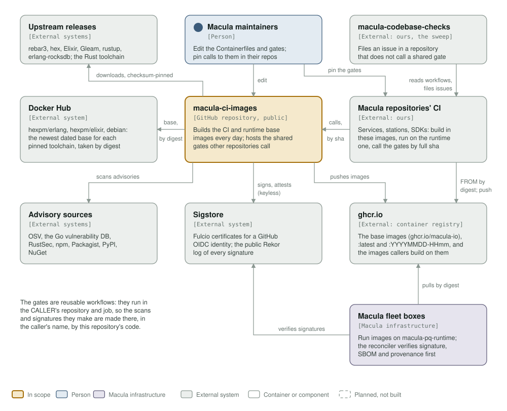
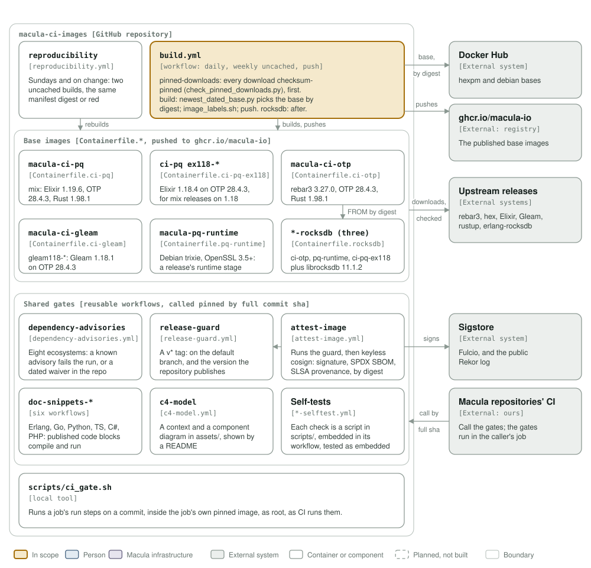

# macula-ci-images architecture: C4 model

*This exists so no pipeline builds a toolchain, and every repository that builds or releases something calls the same checked gates instead of its own copy.*

**Status: 2026-10-22.** The repository carries no version of its own: the images are published as `:latest` and `:YYYYMMDD-HHmm` (with `ex118-` and `gleam118-` prefixes for the variants), and callers pin a shared gate by full commit sha. Everything drawn here is built; nothing is planned.

Legend, the same in both diagrams and the same as mcl-fovea's: amber is the element in scope, blue a person, lavender-grey **Macula infrastructure**, grey-green an external system, white a container or component, and a thin solid rounded outline with a muted label a boundary. Dashed boxes would be planned, not built; there are none.

## Level 1: system context

| Element | Kind | Role |
| --- | --- | --- |
| macula-ci-images | In scope | Builds the CI and runtime base images every day and publishes them; hosts the shared gates (reusable workflows) other repositories call |
| Macula maintainers | Person | Edit the Containerfiles and the gates here; pin calls to the gates in their own repositories |
| Upstream releases | External systems | rebar3, hex, the Elixir source, Gleam, rustup-init and erlang-rocksdb, each downloaded and checked against a checksum pinned in the Containerfile; rustup then fetches the pinned Rust toolchain |
| Docker Hub | External system | `hexpm/erlang`, `hexpm/elixir` and `debian`: `scripts/newest_dated_base.py` picks the newest dated base for the pinned toolchain, and the build takes it by digest |
| ghcr.io | External: container registry | Where `build.yml` pushes the base images (`ghcr.io/macula-io/...`), and where callers push the images they build on them |
| Macula repositories' CI | External: ours | Services, stations and SDKs: build in these images, run on `macula-pq-runtime`, and call the shared gates pinned by full commit sha |
| macula-codebase-checks | External: ours | The cleanup sweep: reads every repository's workflows and files an issue where a repository does not call a shared gate it needs |
| Advisory sources | External systems | What `dependency-advisories.yml` asks, per ecosystem: OSV (osv-scanner), the Go vulnerability database (govulncheck), RustSec (cargo audit), npm, Packagist, PyPI (pip-audit), NuGet |
| Sigstore | External system | `attest-image.yml` signs keylessly: a Fulcio certificate for the GitHub OIDC identity of the caller's run, and every signature and attestation in the public Rekor log |
| Macula fleet boxes | Macula infrastructure | Run service images built on `macula-pq-runtime`; their reconciler verifies the signature, SBOM and provenance `attest-image.yml` made before it runs a digest |

The gates run in the **caller's** repository and job: a reusable workflow is this repository's code executed in someone else's run, so the scans, signatures and checks it makes are made there, in the caller's name.

## Level 3: components

| Component | Kind | Role |
| --- | --- | --- |
| `build.yml` | Workflow: daily 04:00 UTC, weekly uncached, on push, by hand | `pinned-downloads` runs `scripts/check_pinned_downloads.py` (after its own test) before anything is built; `build` resolves each base with `scripts/newest_dated_base.py --pinned`, labels with `scripts/image_labels.sh` and pushes; `rocksdb` builds the derived images afterwards, by digest |
| `reproducibility.yml` | Workflow: Sundays and on change | Two uncached builds of every image into a registry inside the job; the manifest digests must match |
| `macula-ci-pq` | `Containerfile.ci-pq` | mix services: Elixir 1.19.6 on OTP 28.4.3, Rust 1.98.1 |
| `macula-ci-pq` `ex118-*` | `Containerfile.ci-pq-ex118` | Elixir 1.18.4 compiled on OTP 28.4.3, for mix services that release on 1.18 |
| `macula-ci-otp` | `Containerfile.ci-otp` | rebar3 services: OTP 28.4.3, rebar3 3.27.0, Rust 1.98.1 |
| `macula-ci-gleam` `gleam118-*` | `Containerfile.ci-gleam` | Gleam 1.18.1 on OTP 28.4.3 |
| `macula-pq-runtime` | `Containerfile.pq-runtime` | Debian trixie with OpenSSL 3.5+: a release's runtime stage |
| `macula-ci-otp-rocksdb`, `macula-pq-runtime-rocksdb`, `macula-ci-pq-ex118-rocksdb` | `Containerfile.rocksdb` | Built FROM the images above by digest, plus librocksdb 11.1.2 |
| `dependency-advisories` | `dependency-advisories.yml` | A known advisory in any of eight ecosystems fails the caller's run, unless the caller's waiver file names it with a reason, an owner and an expiry |
| `release-guard` | `release-guard.yml` | A `v*` tag must be on the default branch (or its maintenance branch) and be the version the repository publishes |
| `attest-image` | `attest-image.yml` | Runs the release guard, then signs an image by digest with cosign, keyless, and attests its SPDX SBOM and SLSA provenance |
| `doc-snippets-*` | Six workflows: Erlang, Go, Python, TypeScript, C#, PHP | Every code block a repository publishes compiles, and runs where its doc says it runs |
| `c4-model` | `c4-model.yml` | A context and a component diagram in `assets/`, shown by a README |
| Self-tests | `*-selftest.yml`, `scripts/embed_*.sh`, `scripts/test_*` | Each check is a script in `scripts/`, embedded into its workflow; its self-test runs it as embedded |
| `scripts/ci_gate.sh` | Local tool | Runs a job's `run:` steps on a commit inside the job's own pinned image, as root, the way CI runs them |

This repository calls its own `c4-model.yml` from `c4-model-gate.yml`, by local path, on every push and pull request to main, with no path filters.

## Editing the diagrams

Both SVGs in [`../assets/`](../assets/) are generated by [`c4_diagrams.py`](c4_diagrams.py): run `python3 architecture/c4_diagrams.py` from the repository root, render each (`rsvg-convert -w 1400 assets/c4-context.svg -o /tmp/c.png`) and look at it. Colours are plain classes with a `prefers-color-scheme: dark` block, never CSS custom properties, which `rsvg-convert` renders black. Keep this file's tables in step with the diagrams.
